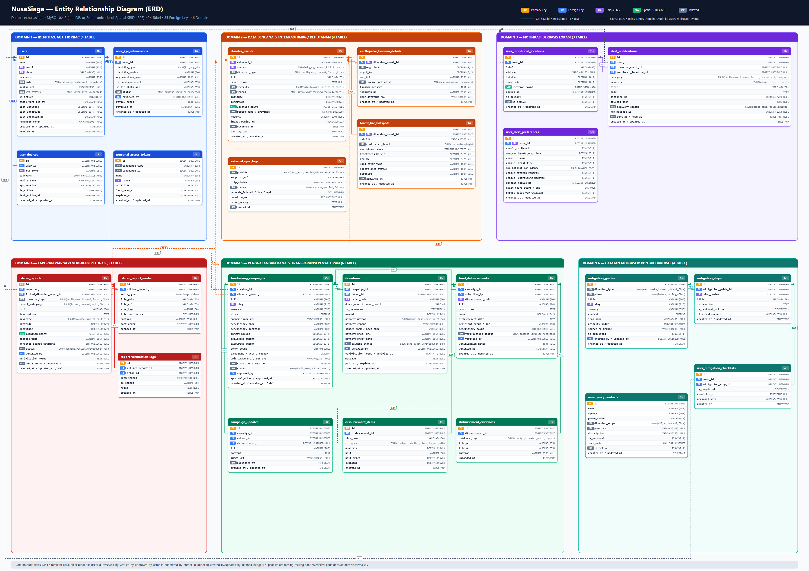

# NusaSiaga

**NusaSiaga** adalah aplikasi mobile yang mengintegrasikan informasi gempa bumi, potensi tsunami, dan titik panas kebakaran hutan dalam satu platform yang terintegrasi dengan **BMKG** dan **Kehutanan (KLHK SiPongi + fallback NASA FIRMS)**.

Fitur utama meliputi:
- **Peta Terpadu Multi-Layer**: Gempa bumi, potensi tsunami, titik panas kebakaran hutan, serta laporan warga terverifikasi dalam satu peta interaktif.
- **Notifikasi Berbasis Lokasi**: Peringatan dini otomatis sesuai posisi GPS dan daftar lokasi pantauan tersimpan dengan radius kustom.
- **Laporan Warga Terverifikasi Petugas**: Pelaporan kondisi lapangan disertai bukti foto/video yang diverifikasi petugas sebelum tampil ke publik.
- **Penggalangan Dana & Transparansi Penyaluran**: Pembuatan kampanye oleh penggagas terverifikasi KYC, donasi (transfer manual terverifikasi admin & mode simulasi), pelacakan progres dana real-time, serta laporan penyaluran dana dengan rincian item dan bukti otentik yang diverifikasi admin.
- **Catatan Mitigasi Bencana**: Panduan keselamatan Pra, Saat, dan Pasca bencana (gempa bumi, tsunami, kebakaran hutan), checklist kesiapsiagaan pribadi, dan direktori kontak darurat dengan dukungan akses offline.

---

## Teknologi & Pemisahan Monorepo

| Layer | Teknologi | Folder |
| :--- | :--- | :--- |
| **Backend REST API** | Laravel + PHP `8.3.33` (Laragon) | [`backend/`](./backend/README.md) |
| **Frontend Mobile** | Flutter `3.47.2` (Android / iOS) | [`frontend/`](./frontend/README.md) |
| **Database** | MySQL `8.4.3` (`InnoDB`, Spatial `SRID 4326`, 24 Tabel) | [`docs/database/`](./docs/database/DATABASE_SCHEMA.md) |

---

## Dokumentasi & Tata Kelola Proyek

| Dokumen | Deskripsi |
| :--- | :--- |
| [`docs/PRD.md`](./docs/PRD.md) | Product Requirements Document (PRD) lengkap NusaSiaga |
| [`docs/database/DATABASE_SCHEMA.md`](./docs/database/DATABASE_SCHEMA.md) | Kamus data lengkap 24 tabel, relasi, aturan bisnis & contoh query spasial |
| [`docs/database/schema.sql`](./docs/database/schema.sql) | Skrip DDL MySQL 8.4.3 terverifikasi |
| [`docs/database/erd-nusasiaga.png`](./docs/database/erd-nusasiaga.png) | Gambar Entity Relationship Diagram (ERD) HD ([versi vektor SVG](./docs/database/erd-nusasiaga.svg)) |
| [`SKILL.md`](./SKILL.md) | Panduan teknis, path Laragon PHP/MySQL, & standar arsitektur |
| [`AGENTS.md`](./AGENTS.md) | Aturan kerja AI Agent & kewajiban `git push` setiap perubahan |
| [`MEMORY.md`](./MEMORY.md) | Memori permanen keputusan teknis & temuan environment |
| [`CHECKPOINT.md`](./CHECKPOINT.md) | Roadmap Fase 1–7 & checklist progres proyek |
| [`LASTGIT.md`](./LASTGIT.md) | Log audit permanen setiap `git commit` & `git push` |

---

## Pratinjau ERD Database (`nusasiaga`)

