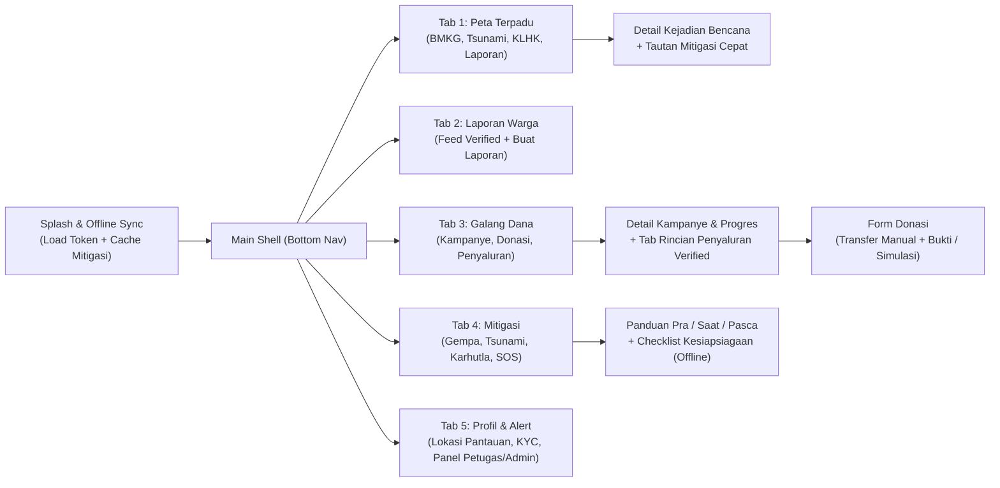

# Product Requirements Document (PRD) — NusaSiaga

| Atribut Dokumen | Detail |
| :--- | :--- |
| **Nama Aplikasi** | **NusaSiaga** |
| **Versi Dokumen** | `1.0.0` (Baseline Fase 1) |
| **Tanggal Penyusunan** | 22 November 2026 |
| **Platform Target** | Mobile Application (**Flutter 3.47.2** — Android / iOS) & REST API (**Laravel** — PHP **8.3.33**) |
| **Database** | **MySQL 8.4.3** (`InnoDB`, `utf8mb4_unicode_ci`, Spatial `SRID 4326`) |
| **Repositori** | `https://github.com/Aliff0305/NusaSiaga.git` (Struktur terpisah `backend/` & `frontend/`) |
| **Referensi Database** | [DATABASE_SCHEMA.md](./database/DATABASE_SCHEMA.md) • [schema.sql](./database/schema.sql) • [ERD](./database/erd-nusasiaga.png) |

---

## 1. Ringkasan Eksekutif & Abstrak Resmi

### 1.1 Abstrak Aplikasi
> **NusaSiaga** adalah aplikasi mobile yang mengintegrasikan informasi gempa bumi, potensi tsunami, dan titik panas kebakaran hutan dalam satu platform yang terintegrasi dengan BMKG dan Kehutanan. Fitur utama meliputi peta terpadu, notifikasi berbasis lokasi, laporan warga yang diverifikasi petugas, serta penggalangan dana untuk korban bencana. Fitur penggalangan dana mencakup pembuatan kampanye oleh penggagas, donasi, pelacakan progres dana, dan laporan penyaluran yang diverifikasi admin untuk menjaga transparansi, serta tambahan catatan mitigasi jika terjadi bencana tersebut.

### 1.2 Visi Produk & Nilai Utama
Indonesia berada di wilayah *Pacific Ring of Fire* sekaligus memiliki kawasan hutan tropis dan lahan gambut yang rentan terhadap bencana hidrometeorologi dan kebakaran hutan. Saat ini informasi kebencanaan, pelaporan lapangan warga, penggalangan bantuan kemanusiaan, dan panduan penyelamatan diri tersebar di berbagai saluran yang terpisah.

**NusaSiaga** menyatukan empat pilar penanganan bencana dalam satu aplikasi mobile:
1. **Deteksi & Peringatan Terpadu** — Menggabungkan data gempa bumi & potensi tsunami resmi BMKG serta titik panas kebakaran hutan dari Kementerian Kehutanan (KLHK SiPongi) ke dalam satu peta interaktif beserta notifikasi berbasis radius lokasi pengguna.
2. **Validasi Kondisi Lapangan (Crowdsourcing Terverifikasi)** — Warga dapat mengirim laporan kondisi riil di sekitar mereka, yang diverifikasi oleh petugas resmi agar bebas dari hoaks sebelum tampil ke publik.
3. **Kemanusiaan & Transparansi Penyaluran Dana** — Menghubungkan donatur dengan penggagas kampanye terverifikasi untuk korban bencana, lengkap dengan pelacakan progres dana serta laporan penggunaan dana yang wajib diverifikasi admin beserta rincian item dan bukti otentik.
4. **Kesiapsiagaan & Catatan Mitigasi** — Menyediakan panduan langkah demi langkah (Pra, Saat, dan Pasca bencana) yang dapat diakses bahkan saat jaringan seluler terganggu (*offline-first*), serta terhubung langsung pada setiap peringatan bahaya.

---

## 2. Latar Belakang Masalah, Tujuan & Indikator Keberhasilan (KPI)

### 2.1 Masalah yang Diselesaikan
| No | Masalah di Lapangan | Solusi di NusaSiaga |
| :---: | :--- | :--- |
| 1 | Informasi gempa/tsunami (BMKG) dan hotspot karhutla (Kehutanan) berada di platform terpisah. | **Peta Terpadu Multi-Layer** yang menyatukan seluruh data ke satu model `disaster_events`. |
| 2 | Warga sering terlambat menerima peringatan relevan dengan lokasi mereka atau lokasi keluarga. | **Notifikasi Berbasis Lokasi** (*GPS live* + daftar lokasi pantauan tersimpan dengan radius custom). |
| 3 | Informasi dampak bencana dari media sosial kerap tidak akurat atau mengandung hoaks. | **Laporan Warga Terverifikasi Petugas** dengan alur status ketat & audit log perubahan status. |
| 4 | Donatur ragu berdonasi karena kurangnya transparansi penggunaan dana bantuan bencana. | **Pelacakan Progres & Laporan Penyaluran Terverifikasi Admin** (rincian item belanja + bukti nota/transfer/foto serah terima). |
| 5 | Kepanikan saat bencana terjadi karena minim akses cepat ke panduan penyelamatan yang bisa dibaca offline. | **Catatan Mitigasi Terstruktur & Cache Offline** + kartu mitigasi kontekstual pada setiap alert bencana. |

### 2.2 KPI Keberhasilan Proyek
- **Keandalan Sinkronisasi Data**: Sukses sinkronisasi data BMKG & Kehutanan ≥ 99% tercatat di `external_sync_logs` dengan latensi ingestion < 60 detik untuk gempa terbaru.
- **Kecepatan Notifikasi Lokasi**: Waktu dari masuknya event kritis (gempa ≥ ambang / potensi tsunami) hingga pengiriman antrean FCM < 30 detik.
- **Integritas Laporan Lapangan**: 100% laporan warga yang tampil di peta publik berstatus `verified` oleh petugas (`officer`/`admin`) dan memiliki entri di `report_verification_logs`.
- **Akuntabilitas Dana 100%**: Saldo tersisa (`collected_amount - disbursed_amount`) selalu konsisten secara matematis, dan 100% rincian penyaluran yang dipublikasikan sebagai resmi berstatus `verified` oleh admin.
- **Ketersediaan Panduan Mitigasi**: 100% catatan mitigasi & kontak darurat dapat dibuka di Flutter meskipun perangkat berada dalam mode offline setelah sinkronisasi awal.

---

## 3. Pengguna Target (Personas) & Matriks Hak Akses (RBAC)

NusaSiaga menggunakan 4 peran utama pada kolom `users.role`:

| Peran (`role`) | Deskripsi Persona | Kemampuan Utama |
| :--- | :--- | :--- |
| **Warga / Donatur** (`citizen`) | Masyarakat umum di wilayah rawan bencana maupun donatur dari daerah lain. | Melihat peta terpadu, menerima alert lokasi, mengatur lokasi pantauan, mengirim laporan warga, berdonasi, melacak progres & penyaluran dana, mengakses catatan mitigasi & checklist. |
| **Penggagas Kampanye** (`campaign_creator`) | Warga/komunitas/relawan yang lolos verifikasi KYC (`users.kyc_status = 'verified'`). | Semua hak `citizen` + mengajukan pembuatan kampanye donasi korban bencana, mempublikasikan kabar kampanye, dan mengajukan laporan penyaluran dana beserta bukti nota/foto. |
| **Petugas Lapangan / BPBD** (`officer`) | Aparat/relawan terotorisasi yang memvalidasi kebenaran laporan kondisi lapangan. | Memeriksa antrean laporan warga, mengubah status (`under_review`, `verified`, `rejected`, `resolved`), menautkan laporan ke event bencana peta, serta mencatat catatan verifikasi. |
| **Administrator** (`admin`) | Pengelola sistem, auditor transparansi dana, dan kurator konten mitigasi. | Seluruh hak `officer` + verifikasi KYC penggagas, persetujuan kampanye, **verifikasi bukti transfer donasi manual**, **verifikasi laporan penyaluran dana**, manajemen catatan mitigasi & kontak darurat, serta monitoring log sinkronisasi API eksternal. |

### Matriks Izin Fitur (RBAC)

| Modul / Aksi | `citizen` | `campaign_creator` | `officer` | `admin` |
| :--- | :---: | :---: | :---: | :---: |
| Lihat Peta Terpadu & Detail Bencana | ✅ | ✅ | ✅ | ✅ |
| Kelola Lokasi Pantauan & Preferensi Alert | ✅ | ✅ | ✅ | ✅ |
| Kirim Laporan Warga + Unggah Media | ✅ | ✅ | ✅ | ✅ |
| Verifikasi / Tolak Laporan Warga | ❌ | ❌ | ✅ | ✅ |
| Ajukan KYC Penggagas Kampanye | ✅ | — | ❌ | ❌ |
| Review & Setujui KYC Penggagas | ❌ | ❌ | ❌ | ✅ |
| Buat Kampanye Penggalangan Dana | ❌ | ✅ | ❌ | ✅ |
| Setujui / Tolak Publikasi Kampanye | ❌ | ❌ | ❌ | ✅ |
| Berdonasi (Transfer Manual / Simulasi) | ✅ | ✅ | ✅ | ✅ |
| Verifikasi Bukti Transfer Donasi Manual | ❌ | ❌ | ❌ | ✅ |
| Ajukan Laporan Penyaluran Dana & Bukti | ❌ | ✅ *(milik sendiri)* | ❌ | ✅ |
| Verifikasi Laporan Penyaluran Dana | ❌ | ❌ | ❌ | ✅ |
| Baca Catatan Mitigasi & Isi Checklist | ✅ | ✅ | ✅ | ✅ |
| Kelola Konten Mitigasi & Kontak Darurat | ❌ | ❌ | ❌ | ✅ |
| Pantau `external_sync_logs` & Trigger Sync | ❌ | ❌ | ✅ *(lihat)* | ✅ *(kelola)* |

---

## 4. Kebutuhan Fungsional Lengkap

### FR-01 — Autentikasi, Profil Pengguna & KYC Penggagas
- **Deskripsi**: Pengelolaan registrasi, login aman berbasis Laravel Sanctum, pembaruan koordinat GPS perangkat, registrasi token FCM (`user_devices`), serta alur pengajuan KYC bagi warga yang ingin menjadi penggagas kampanye.
- **Alur Bisnis KYC**:
  1. Pengguna (`citizen`) mengunggah jenis identitas (`ktp` atau `organization_sk`), nomor identitas, foto dokumen, dan foto selfie ke `user_kyc_submissions`.
  2. Status `users.kyc_status` berubah menjadi `pending`.
  3. `admin` meninjau berkas: jika valid, `kyc_status` menjadi `verified` dan `users.role` dipromosikan ke `campaign_creator`; jika ditolak, `review_notes` wajib diisi.
- **Acceptance Criteria**:
  - Registrasi menolak email atau nomor telepon duplikat.
  - Token Sanctum disimpan aman di Flutter (`flutter_secure_storage`).
  - Pengguna dengan `kyc_status != 'verified'` ditolak dengan HTTP `403` saat mencoba membuat kampanye.

---

### FR-02 — Integrasi Data Real-Time BMKG & Kehutanan
- **Deskripsi**: Backend Laravel menjalankan scheduler otomatis untuk menarik, menormalisasi, dan menduplikasi-aman (*idempotent upsert* via `(source, external_id)`) data kebencanaan dari instansi resmi ke tabel `disaster_events` dan tabel detailnya.
- **Sumber Data yang Ditetapkan**:
  1. **BMKG Open Data**:
     - Gempa Bumi Terbaru (`autogempa.json`) — termasuk Shakemap & status potensi tsunami.
     - Daftar 15 Gempa Terkini M ≥ 5.0 (`gempaterkini.json`).
     - Daftar Gempa Dirasakan / skala MMI (`gempadirasakan.json`).
     - Informasi Peringatan Dini Tsunami InaTEWS bila status `waspada`, `siaga`, atau `awas`.
     - Disimpan ke `disaster_events` + `earthquake_tsunami_details`.
  2. **Kehutanan (Kebakaran Hutan & Lahan)**:
     - **Sumber Primer**: **KLHK SiPongi** (Kementerian Kehutanan — data hotspot sebaran titik panas Indonesia, status kawasan hutan, dan tingkat kepercayaan).
     - **Sumber Fallback / Enrichment**: **NASA FIRMS** (VIIRS/MODIS *bounding box* wilayah Indonesia: `94.0°E–141.5°E`, `11.5°S–6.5°N`) yang otomatis aktif apabila endpoint KLHK SiPongi mengalami timeout, downtime, atau butuh pengayaan metrik satelit (`brightness_kelvin`, `frp_mw`).
     - Disimpan ke `disaster_events` + `forest_fire_hotspots`.
- **Frekuensi Sinkronisasi & Audit**:
  - BMKG Autogempa: setiap **1–2 menit**.
  - BMKG Gempa Terkini & Dirasakan: setiap **5 menit**.
  - Kehutanan (KLHK SiPongi / NASA FIRMS fallback): setiap **15–30 menit**.
  - Setiap eksekusi wajib menulis log ke `external_sync_logs` (`provider`, `http_status`, `status`, `records_fetched`, `records_inserted`, `records_updated`, `duration_ms`, `error_message`).
- **Acceptance Criteria**:
  - Data duplikat dari polling berulang tidak membuat baris ganda di `disaster_events`.
  - Jika KLHK SiPongi gagal dihubungi (HTTP ≥ 500 atau timeout), sistem mencatat status `failed` di `external_sync_logs` dan secara otomatis menjalankan fallback `nasa_firms`.
  - Event baru yang lolos kriteria langsung memicu evaluasi antrean notifikasi lokasi (FR-04).

---

### FR-03 — Peta Terpadu Multi-Layer
- **Deskripsi**: Layar utama aplikasi mobile menampilkan satu peta interaktif Indonesia yang memadukan seluruh informasi kebencanaan dalam satu tampilan terpadu.
- **Layer Peta**:
  1. **Layer Gempa Bumi**: Marker berkode warna berdasarkan magnitudo/severity (`info` < 4.0, `medium` 4.0–4.9, `high` 5.0–5.9, `critical` ≥ 6.0), lengkap dengan popup magnitudo, kedalaman, MMI, wilayah, dan tombol lihat Shakemap.
  2. **Layer Potensi Tsunami**: Highlight khusus dengan animasi/badge peringatan (`Waspada`, `Siaga`, `Awas`), pesan evakuasi BMKG, serta tombol pintas ke **Catatan Mitigasi Tsunami**.
  3. **Layer Titik Panas Kehutanan**: Marker klaster / titik panas karhutla dengan warna sesuai `confidence_level` (`low` kuning, `medium` oranye, `high` merah gelap), menampilkan satelit, confidence score, FRP (MW), dan status kawasan hutan.
  4. **Layer Laporan Warga Terverifikasi**: Marker hijau/biru bertanda **"Terverifikasi Petugas"** hanya untuk `citizen_reports.status IN ('verified', 'resolved')`.
- **Filter & Pencarian Peta**:
  - Toggle aktif/nonaktif per layer.
  - Filter rentang waktu (`24 jam`, `7 hari`, `30 hari`), minimal magnitudo gempa, minimal confidence hotspot, pencarian provinsi/kabupaten, dan filter radius dari lokasi pengguna.
- **Acceptance Criteria**:
  - Peta mendukung *marker clustering* saat titik panas berjumlah ratusan agar UI Flutter tetap 60fps.
  - Setiap bottom-sheet detail kejadian di peta memiliki tombol **"Lihat Catatan Mitigasi Terkait"** dan **"Laporkan Kondisi Sekitar"**.

---

### FR-04 — Notifikasi Berbasis Lokasi
- **Deskripsi**: Pengiriman push notification FCM dan kotak masuk alert yang dipersonalisasi berdasarkan posisi geografis pengguna serta lokasi pantauan tersimpan.
- **Mekanisme Pencocokan Spasial**:
  - Sistem mengevaluasi koordinat `disaster_events.location_point` (`SRID 4326`) menggunakan `ST_Distance_Sphere` terhadap:
    1. Lokasi GPS terakhir pengguna (`users.last_latitude`, `users.last_longitude`) dengan `user_alert_preferences.default_radius_km`.
    2. Setiap lokasi pantauan aktif (`user_monitored_locations` dengan `radius_km` masing-masing, mis. "Rumah Orang Tua — radius 150 km").
  - Filter ambang:
    - Gempa: `magnitude >= user_alert_preferences.min_earthquake_magnitude`.
    - Hotspot: `confidence_level >= user_alert_preferences.min_hotspot_confidence`.
    - Tsunami (`waspada`/`siaga`/`awas`): selalu dikirim jika `enable_tsunami = 1` dan dalam radius pantauan (atau radius pesisir lebih luas).
  - **Quiet Hours & Critical Bypass**: Pada jam senyap (`quiet_hours_start` s/d `quiet_hours_end`), alert `normal` masuk ke inbox tanpa suara keras/push atau ditunda, sedangkan alert `critical` (gempa merusak / potensi tsunami) menembus jam senyap jika `bypass_quiet_for_critical = 1`.
- **Acceptance Criteria**:
  - Pengguna dapat menambah, mengubah radius, mengaktifkan/menonaktifkan, dan menghapus lokasi pantauan.
  - Setiap item di kotak masuk `alert_notifications` menampilkan jarak kejadian (`distance_km`), label lokasi pantauan yang terdampak, serta tombol aksi cepat ke Peta dan Catatan Mitigasi.

---

### FR-05 — Laporan Warga & Verifikasi Petugas
- **Deskripsi**: Sarana bagi warga di lokasi bencana untuk mengirimkan laporan situasi faktual beserta bukti visual, yang wajib diverifikasi petugas sebelum disebarluaskan.
- **User Story**:
  - *Sebagai Warga*, saya dapat melaporkan getaran kuat, tanda tsunami, kabut asap pekat, api aktif, kerusakan infrastruktur, atau kebutuhan evakuasi beserta foto/video dan koordinat GPS akurat.
  - *Sebagai Petugas (`officer`)*, saya dapat meninjau antrean laporan masuk, memeriksa foto bukti dan kedekatannya dengan data BMKG/Kehutanan, lalu memverifikasi atau menolak laporan dengan catatan jelas.
- **Alur Status (`citizen_reports.status`)**:
  1. `pending` — Baru dikirim warga (hanya terlihat oleh pelapor dan petugas/admin).
  2. `under_review` — Sedang diperiksa/dikonfirmasi petugas.
  3. `verified` — Dinyatakan valid oleh petugas; otomatis tercatat di `report_verification_logs`, dapat ditautkan ke `disaster_events` eksisting atau dipublikasikan ke layer peta, serta memicu alert ke pengguna sekitar.
  4. `rejected` — Ditolak (hoaks/duplikat/tidak valid) dengan `verification_notes` wajib diisi.
  5. `resolved` — Kondisi darurat pada laporan tersebut telah tertangani.
- **Acceptance Criteria**:
  - Laporan wajib menyertakan minimal judul, deskripsi, jenis bencana, kategori, koordinat, dan direkomendasikan melampirkan minimal 1 foto.
  - Laporan berstatus `pending` atau `rejected` **tidak boleh** muncul di endpoint peta publik warga lain.
  - Setiap transisi status menghasilkan 1 record audit baru di `report_verification_logs`.

---

### FR-06 — Penggalangan Dana Korban Bencana & Transparansi Penyaluran
Fitur ini mencakup empat sub-fitur wajib sesuai abstrak aplikasi:

1. **Pembuatan Kampanye oleh Penggagas (`fundraising_campaigns`)**:
   - Hanya pengguna dengan `role IN ('campaign_creator', 'admin')` dan `kyc_status = 'verified'` yang dapat membuat kampanye.
   - Data wajib: judul, bencana terkait (opsional taut ke `disaster_events`), ringkasan, cerita lengkap, nama & lokasi penerima manfaat, target dana (`target_amount`), tanggal berakhir (`ends_at`), rekening tujuan (`bank_name`, `bank_account_number`, `bank_account_holder`, opsional `qris_image_url`), dan dokumen pendukung posko.
   - Kampanye baru berstatus `pending_approval` hingga disetujui oleh `admin` (`status = 'active'`).

2. **Donasi (Transfer Manual Terverifikasi Admin & Mode Simulasi)**:
   - Mengikuti keputusan arsitektur v1 tanpa payment gateway pihak ketiga:
     - **Metode A — Transfer Manual (`manual_transfer`)**:
       1. Donatur memilih nominal, opsi anonim (`is_anonymous`), doa/pesan dukungan, dan kanal transfer ke rekening/QRIS kampanye.
       2. Transaksi terbentuk dengan `order_code` unik dan `payment_status = 'pending'`.
       3. Donatur mentransfer dana lalu mengunggah bukti transfer (`payment_proof_url`, nama bank pengirim, nama pengirim, dan catatan referensi) → status menjadi `'awaiting_verification'`.
       4. Admin memeriksa kecocokan bukti transfer pada dashboard/panel verifikasi dan menekan **Setujui (`verified`)** atau **Tolak (`rejected`)**.
     - **Metode B — Mode Simulasi (`simulation`)**:
       1. Tersedia saat konfigurasi server mengizinkan mode uji/demo (`ALLOW_DONATION_SIMULATION=true`), memungkinkan penguji/dosen/reviewer mensimulasikan donasi instan untuk memverifikasi pelacakan progres dan alur penyaluran tanpa transfer bank riil.
       2. Tetap tercatat jelas di database sebagai `payment_method = 'simulation'` agar terpisah dalam laporan audit.
   - Saat donasi berstatus `verified`, backend secara atomik menambah `collected_amount` dan `donor_count` pada `fundraising_campaigns`.

3. **Pelacakan Progres Dana Real-Time**:
   - Halaman detail kampanye menampilkan:
     - Total dana terkumpul (`collected_amount`), target (`target_amount`), persentase capaian, sisa hari, dan jumlah donatur terverifikasi.
     - **Ringkasan Transparansi Keuangan**: Total Terkumpul vs Total Disalurkan Terverifikasi (`disbursed_amount`) vs Sisa Dana Belum Disalurkan (`collected_amount - disbursed_amount`).
     - Daftar donatur terbaru (menghormati flag `is_anonymous` sebagai *"Hamba Allah / Donatur Anonim"*) beserta doa dukungan.
     - Timeline `campaign_updates` dan riwayat penyaluran.

4. **Laporan Penyaluran Dana Terverifikasi Admin (`fund_disbursements`)**:
   - Penggagas kampanye membuat laporan penyaluran dana dengan mengisi:
     - Judul & deskripsi penyaluran, tanggal penyaluran, kelompok & lokasi penerima, estimasi penerima manfaat.
     - **Rincian Item Penggunaan Dana (`disbursement_items`)**: nama item, kategori (`food_water`, `medical`, `shelter`, `clothing`, `logistics`, `recovery`, `other`), jumlah, satuan, harga satuan, subtotal.
     - **Bukti Penyaluran (`disbursement_evidences`)**: minimal 1 foto nota/kwitansi/bukti transfer & foto penyerahan di lapangan.
   - Aturan Validasi Ketat:
     - `SUM(disbursement_items.subtotal)` **harus sama persis** dengan `fund_disbursements.amount`.
     - Total akumulasi penyaluran tidak boleh melebihi `collected_amount`.
   - Laporan baru berstatus `pending_verification`.
   - **Admin** memverifikasi kecocokan rincian item dengan bukti nota/foto:
     - Jika disetujui → `verification_status = 'verified'`, `verified_by`, `verified_at` terisi, dan `fundraising_campaigns.disbursed_amount` bertambah secara atomik; laporan tampil ke publik dengan lencana **"Terverifikasi Admin"**.
     - Jika bukti kurang/tidak cocok → `verification_status = 'rejected'` beserta `verification_notes` agar penggagas dapat memperbaiki.

---

### FR-07 — Catatan Mitigasi Bencana & Kesiapsiagaan Offline
- **Deskripsi**: Pusat edukasi dan tindakan cepat mitigasi bencana untuk **Gempa Bumi**, **Tsunami**, dan **Kebakaran Hutan** yang terbagi atas 3 fase: **Sebelum Bencana (`before`)**, **Saat Terjadi (`during`)**, dan **Setelah Bencana (`after`)**.
- **Fitur Utama**:
  1. **Panduan Langkah-Demi-Langkah (`mitigation_guides` + `mitigation_steps`)**: Setiap langkah dilengkapi tanda `is_critical_action` (aksi darurat prioritas utama berwarna merah/oranye agar langsung terbaca dalam kondisi panik, mis. *"Lindungi Kepala — Drop, Cover, Hold On"*, *"Segera Menuju Dataran Tinggi > 30m"*, *"Gunakan Masker N95 & Tutup Ventilasi Asap"*).
  2. **Integrasi Kontekstual dengan Alert & Peta**: Setiap notifikasi gempa, potensi tsunami, atau titik panas karhutla memiliki tautan langsung ke catatan mitigasi jenis bencana terkait pada fase `during`.
  3. **Checklist Kesiapsiagaan Pribadi (`user_mitigation_checklists`)**: Pengguna dapat mencentang daftar persiapan (Tas Siaga Bencana, titik kumpul keluarga, pemutusan aliran listrik/gas) dan menyimpan catatan pribadi.
  4. **Direktori Kontak Darurat (`emergency_contacts`)**: Daftar panggilan 1-ketuk (*tel:* link) untuk BNPB (`117`), Basarnas (`115`), Pemadam Kebakaran (`113`), Ambulans (`119`), dan BPBD/Posko Karhutla provinsi.
  5. **Dukungan Offline-First**: Aplikasi Flutter menyimpan salinan lokal (`SQLite` / `Hive`) seluruh panduan mitigasi, langkah aksi, dan kontak darurat saat aplikasi sinkron online, sehingga tetap dapat dibuka tanpa internet ketika terjadi bencana besar.

---

## 5. Kebutuhan Non-Fungsional

| Kategori | Spesifikasi Target |
| :--- | :--- |
| **Performa API** | Waktu respons endpoint peta & daftar kampanye P95 ≤ 400 ms untuk dataset regional; query spasial menggunakan `POINT SRID 4326` + indeks komposit. |
| **Keamanan** | Autentikasi Bearer Token (Laravel Sanctum), hashing password bcrypt/argon2, validasi MIME & ukuran file unggahan (maks. 5MB gambar / 20MB video), proteksi RBAC via Laravel Policies/Middleware, rate limiting pada endpoint login, laporan, dan donasi. |
| **Keandalan & Offline** | Cache lokal Flutter untuk `mitigation_guides`, `mitigation_steps`, `emergency_contacts`, serta data gempa terakhir. Antrean pengiriman FCM ditangani Laravel Queue agar tidak memblokir proses sinkronisasi data. |
| **Transparansi & Audit** | Seluruh aksi sensitif (verifikasi laporan warga, verifikasi donasi manual, verifikasi penyaluran dana, sinkronisasi API eksternal) memiliki pencatatan aktor dan timestamp yang persisten. |
| **Maintainability** | Pemisahan kode bersih antara `backend/` (Laravel Service/Action pattern) dan `frontend/` (Flutter Feature-First architecture), seluruh perubahan terdokumentasi di `CHECKPOINT.md` dan `LASTGIT.md` via `git push`. |

---

## 6. Arsitektur Teknis & Pemisahan Repositori

Proyek dikelola dalam satu repositori Git dengan pemisahan folder eksplisit:

```text
C:\NusaSiaga\
├── backend/       # REST API, Scheduler Sync BMKG/KLHK, Geo-Alert Engine, Admin/Officer API (Laravel - PHP 8.3.33)
├── frontend/      # Aplikasi Mobile Android/iOS (Flutter 3.47.2)
├── docs/          # PRD.md & dokumentasi/skema database MySQL 8.4.3
└── (*.md root)    # SKILL.md, AGENTS.md, MEMORY.md, CHECKPOINT.md, LASTGIT.md, README.md
```

### Stack Teknologi
- **Backend**: Laravel (PHP `8.3.33` dari `C:\laragon\bin\php\php-8.3.33-Win32-vs16-x64`), Laravel Sanctum, Laravel Queue & Scheduler, Guzzle HTTP Client.
- **Database**: MySQL `8.4.3` (`C:\laragon\bin\mysql\mysql-8.4.3-winx64\bin`), Spatial `SRID 4326`.
- **Frontend**: Flutter `3.47.2` (`C:\flutter_windows_3.47.2-stable`), `dio` (HTTP client), `flutter_map` / OpenStreetMap (atau Google Maps SDK), `geolocator`, `firebase_messaging`, `sqflite` / `hive` untuk cache offline mitigasi, `image_picker`, `flutter_secure_storage`.

---

## 7. Ringkasan Kontrak REST API v1

Base URL: `/api/v1` (Format JSON standar: `{ "success": true, "message": "...", "data": ..., "meta": ... }`).

| Modul | Method | Endpoint | Akses | Fungsi |
| :--- | :---: | :--- | :--- | :--- |
| **Auth & Profil** | `POST` | `/auth/register`, `/auth/login`, `/auth/logout` | Publik / Auth | Registrasi, login Sanctum, logout |
| | `GET/PUT` | `/me`, `/me/location`, `/me/devices` | Auth | Profil, update GPS terakhir, daftar token FCM |
| | `POST/GET` | `/kyc/submissions`, `/kyc/me` | `citizen` | Pengajuan & status verifikasi KYC penggagas |
| **Bencana & Peta** | `GET` | `/map/overview` | Publik | Feed gabungan layer peta (gempa, tsunami, hotspot, laporan verified) |
| | `GET` | `/disasters`, `/disasters/{id}` | Publik | Daftar & detail event bencana (`raw`, seismik, hotspot) |
| **Lokasi & Alert** | `GET/POST/PUT/DEL` | `/monitored-locations` | Auth | CRUD lokasi pantauan & radius |
| | `GET/PUT` | `/alert-preferences` | Auth | Pengaturan ambang magnitudo/confidence & quiet hours |
| | `GET/PATCH` | `/notifications`, `/notifications/{id}/read` | Auth | Kotak masuk alert lokasi & tandai sudah dibaca |
| **Laporan Warga** | `GET/POST` | `/reports`, `/reports/{id}` | Publik / Auth | Kirim laporan warga + upload foto/video; list publik hanya `verified` |
| | `GET/PATCH` | `/officer/reports`, `/officer/reports/{id}/verify` | `officer`, `admin` | Antrean & eksekusi verifikasi petugas (`verified`/`rejected`/`resolved`) |
| **Penggalangan Dana** | `GET/POST/PUT` | `/campaigns`, `/campaigns/{slug}` | Publik / `creator` | Katalog kampanye, detail progres, pembuatan kampanye baru |
| | `POST` | `/campaigns/{id}/donations` | Auth / Publik | Buat transaksi donasi (`manual_transfer` / `simulation`) |
| | `POST` | `/donations/{orderCode}/proof` | Auth | Unggah bukti transfer manual |
| | `GET/POST` | `/campaigns/{id}/disbursements` | Publik / `creator` | Lihat laporan penyaluran terverifikasi & ajukan penyaluran + item + bukti |
| | `POST` | `/campaigns/{id}/updates` | `creator`, `admin` | Publikasi kabar terbaru kampanye |
| **Verifikasi Admin** | `PATCH` | `/admin/kyc/{id}/review` | `admin` | Setujui / tolak pengajuan KYC |
| | `PATCH` | `/admin/campaigns/{id}/approve` | `admin` | Setujui / tolak kampanye |
| | `GET/PATCH` | `/admin/donations`, `/admin/donations/{id}/verify` | `admin` | Antrean & verifikasi bukti transfer manual donatur |
| | `GET/PATCH` | `/admin/disbursements`, `/admin/disbursements/{id}/verify` | `admin` | Antrean & verifikasi transparansi laporan penyaluran dana |
| | `GET/POST` | `/admin/sync-logs`, `/admin/sync/trigger` | `officer`/`admin` | Monitor log sinkronisasi BMKG/KLHK & pemicu manual sync |
| **Mitigasi** | `GET` | `/mitigations`, `/mitigations/{slug}` | Publik | Panduan mitigasi (mendukung parameter `?updated_after=` untuk sync offline) |
| | `GET/PUT` | `/me/mitigation-checklists` | Auth | Sinkronisasi status checklist kesiapsiagaan |
| | `GET` | `/emergency-contacts` | Publik | Direktori nomor darurat nasional & daerah |

---

## 8. Arsitektur Informasi & Alur Layar Mobile (Flutter)



---

## 9. Roadmap Implementasi Proyek (Fase 1–7)

| Fase | Fokus Utama | Deliverable Kunci |
| :---: | :--- | :--- |
| **Fase 1** *(Selesai)* | Perencanaan, PRD, Schema Database & Tata Kelola | `PRD.md`, `schema.sql` (24 tabel teruji MySQL 8.4), `erd-nusasiaga.svg/png`, `DATABASE_SCHEMA.md`, `SKILL.md`, `AGENTS.md`, `MEMORY.md`, `CHECKPOINT.md`, `LASTGIT.md` |
| **Fase 2** | Inisialisasi Proyek Backend & Frontend | Scaffold Laravel di `backend/`, migrasi Eloquent + Seeder mitigasi & kontak darurat, scaffold Flutter di `frontend/`, setup autentikasi Sanctum & RBAC |
| **Fase 3** | Integrasi BMKG, Kehutanan & Peta Terpadu | Service & Scheduler BMKG + KLHK SiPongi (+ NASA FIRMS fallback), endpoint `map/overview`, UI Peta Terpadu multi-layer Flutter |
| **Fase 4** | Notifikasi Berbasis Lokasi | CRUD `user_monitored_locations`, `user_alert_preferences`, Geo-Alert Engine (`ST_Distance_Sphere`), integrasi FCM & inbox notifikasi |
| **Fase 5** | Laporan Warga & Verifikasi Petugas | Upload laporan + media warga, panel verifikasi petugas (`officer`), audit `report_verification_logs`, publikasi otomatis ke peta |
| **Fase 6** | Penggalangan Dana & Transparansi Penyaluran | Alur KYC, pembuatan kampanye, donasi transfer manual (+ upload bukti) & simulasi, panel verifikasi donasi & penyaluran admin, UI progres & rincian item transparan |
| **Fase 7** | Mitigasi Offline, Pengujian & Rilis | Modul mitigasi offline-first Flutter, checklist kesiapsiagaan, pengujian API (PHPUnit/Pest) & widget/integration test Flutter, dokumentasi akhir |

---

## 10. Manajemen Risiko & Rencana Mitigasi Teknis

| Risiko | Dampak | Strategi Mitigasi |
| :--- | :--- | :--- |
| Endpoint KLHK SiPongi sementara tidak dapat diakses / berubah format | Data hotspot karhutla kosong | Mekanisme fallback otomatis ke NASA FIRMS (VIIRS/MODIS wilayah Indonesia) dengan adapter pattern & audit `external_sync_logs`. |
| Inversi koordinat pada query spasial MySQL 8.4 (`SRID 4326`) | Perhitungan jarak notifikasi salah atau error SQL 3732 | Menggunakan helper koordinat tunggal terpusat di Laravel dengan `ST_GeomFromText(..., 4326, 'axis-order=long-lat')` atau `ST_SRID(POINT(lng, lat), 4326)` dan unit test spasial wajib. |
| Lonjakan spam laporan warga atau manipulasi dana | Penurunan kepercayaan publik | Laporan warga baru wajib `pending` sebelum masuk peta; penggagas kampanye wajib KYC `verified`; penyaluran dana wajib verifikasi bukti nota & foto oleh admin sebelum dihitung ke `disbursed_amount`. |
| Pengguna kehilangan sinyal internet saat bencana terjadi | Tidak bisa membaca panduan keselamatan | Seluruh tabel mitigasi dan kontak darurat disinkronkan ke penyimpanan lokal Flutter (`offline-first`). |
