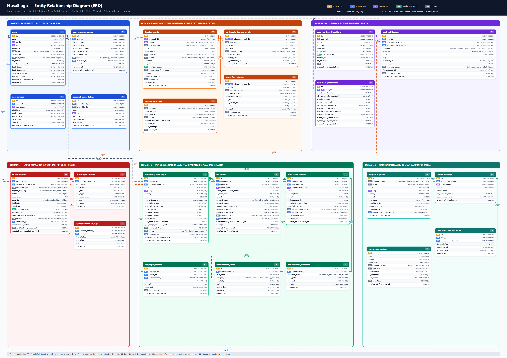
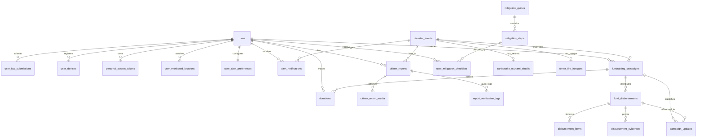

# Dokumentasi Schema Database — NusaSiaga (`nusasiaga`)

> **Database Engine**: MySQL `8.4.3` (Laragon) • **Storage Engine**: `InnoDB` • **Charset / Collation**: `utf8mb4` / `utf8mb4_unicode_ci` • **Total**: **24 Tabel**, **35 Foreign Keys**, **3 Spatial Indexes (`SRID 4326`)**, **6 Domain**.
>
> File DDL terverifikasi: [`schema.sql`](./schema.sql) • Gambar Vektor: [`erd-nusasiaga.svg`](./erd-nusasiaga.svg) • Gambar Raster HD: [`erd-nusasiaga.png`](./erd-nusasiaga.png)

---

## 1. Entity Relationship Diagram (ERD)



### Diagram Ringkas Relasi Antar-Entitas (Mermaid)



---

## 2. Arsitektur Domain & Konvensi Desain

| Domain | Jumlah Tabel | Daftar Tabel | Tanggung Jawab Utama |
| :--- | :---: | :--- | :--- |
| **1. Identitas, Auth & RBAC** | 4 | `users`, `user_kyc_submissions`, `user_devices`, `personal_access_tokens` | Akun multi-peran, verifikasi KYC penggagas kampanye, token FCM, token API Laravel Sanctum |
| **2. Data Bencana & Integrasi Eksternal** | 4 | `disaster_events`, `earthquake_tsunami_details`, `forest_fire_hotspots`, `external_sync_logs` | Data terpadu gempa/tsunami BMKG & titik panas karhutla KLHK SiPongi (+ NASA FIRMS fallback) |
| **3. Notifikasi Berbasis Lokasi** | 3 | `user_monitored_locations`, `user_alert_preferences`, `alert_notifications` | Lokasi pantauan ber-radius, ambang filter alert, *quiet hours*, dan log pengiriman FCM |
| **4. Laporan Warga & Verifikasi Petugas** | 3 | `citizen_reports`, `citizen_report_media`, `report_verification_logs` | Pelaporan warga dari lapangan, bukti foto/video, dan jejak audit verifikasi petugas |
| **5. Penggalangan Dana & Transparansi** | 6 | `fundraising_campaigns`, `donations`, `fund_disbursements`, `disbursement_items`, `disbursement_evidences`, `campaign_updates` | Kampanye, donasi (transfer manual terverifikasi admin & simulasi), progres dana, serta laporan penyaluran terverifikasi admin |
| **6. Catatan Mitigasi & Kontak Darurat** | 4 | `mitigation_guides`, `mitigation_steps`, `user_mitigation_checklists`, `emergency_contacts` | Panduan mitigasi pra/saat/pasca bencana, checklist kesiapsiagaan pribadi, hotline darurat |

### Konvensi Standar
- **Primary Key**: Seluruh tabel menggunakan `BIGINT UNSIGNED AUTO_INCREMENT` (`id`) agar kompatibel penuh dengan konvensi Laravel Eloquent.
- **Timezone**: Seluruh timestamp operasional diset ke `+07:00` (WIB) saat koneksi database dan disimpan konsisten oleh Laravel (`Asia/Jakarta` / UTC dikonversi di API resource).
- **Soft Deletes**: Diterapkan pada entitas sensitif (`users`, `citizen_reports`, `fundraising_campaigns`) melalui kolom `deleted_at`.
- **Audit Trail**: Perubahan status verifikasi laporan warga (`report_verification_logs`), verifikasi donasi manual (`donations.verified_by`), dan verifikasi penyaluran dana (`fund_disbursements.verified_by`) dicatat secara eksplisit.

---

## 3. Catatan Penting Spasial MySQL 8.4 (`SRID 4326`)

Pada **MySQL 8.4.3**, kolom spasial pada `disaster_events`, `user_monitored_locations`, dan `citizen_reports` didefinisikan sebagai:

```sql
`location_point` POINT NOT NULL SRID 4326
```

> [!IMPORTANT]
> **Aturan Urutan Koordinat (Axis Order) yang Telah Diuji di MySQL 8.4.3 Laragon:**
> 1. Dalam WKT (`ST_GeomFromText`), `SRID 4326` secara default mengikuti standar EPSG **(latitude terlebih dahulu, lalu longitude)**:
>    - Contoh benar: `ST_GeomFromText('POINT(-6.2088 106.8456)', 4326)`
>    - Atau dengan opsi eksplisit: `ST_GeomFromText('POINT(106.8456 -6.2088)', 4326, 'axis-order=long-lat')`
> 2. Dalam fungsi constructor biner `POINT(x, y)` + `ST_SRID(..., 4326)`:
>    - `POINT(x, y)` menerima **`(longitude, latitude)`**, bukan `(lat, lng)`!
>    - Contoh benar: `ST_SRID(POINT(106.8456, -6.2088), 4326)`
>    - Jika dibalik menjadi `ST_SRID(POINT(-6.2088, 106.8456), 4326)`, MySQL 8.4 akan menolak dengan **ERROR 3732: latitude 106.845600 out of range [-90, 90]**.

---

## 4. Kamus Data Lengkap (24 Tabel)

### Domain 1 — Identitas, Autentikasi & RBAC

#### 1. `users`
Menyimpan seluruh akun pengguna dengan kontrol akses berbasis peran (RBAC) dan status KYC.

| Kolom | Tipe Data | Null | Default | Key | Keterangan |
| :--- | :--- | :---: | :--- | :---: | :--- |
| `id` | `BIGINT UNSIGNED` | NO | `AUTO_INCREMENT` | `PK` | ID unik pengguna |
| `name` | `VARCHAR(150)` | NO | — | — | Nama lengkap pengguna / lembaga |
| `email` | `VARCHAR(191)` | NO | — | `UK` | Email unik untuk login |
| `phone` | `VARCHAR(30)` | YES | `NULL` | `UK` | Nomor WhatsApp / telepon aktif |
| `password` | `VARCHAR(255)` | NO | — | — | Hash password Laravel |
| `role` | `ENUM('citizen','campaign_creator','officer','admin')` | NO | `'citizen'` | `IDX` | Peran RBAC pengguna |
| `avatar_url` | `VARCHAR(255)` | YES | `NULL` | — | URL foto profil |
| `kyc_status` | `ENUM('unverified','pending','verified','rejected')` | NO | `'unverified'` | `IDX` | Status kelayakan menggagas kampanye |
| `is_active` | `TINYINT(1)` | NO | `1` | `IDX` | Flag aktif akun |
| `email_verified_at` | `TIMESTAMP` | YES | `NULL` | — | Waktu verifikasi email |
| `last_latitude` | `DECIMAL(10,7)` | YES | `NULL` | — | Latitude GPS terakhir perangkat |
| `last_longitude` | `DECIMAL(10,7)` | YES | `NULL` | — | Longitude GPS terakhir perangkat |
| `last_location_at` | `TIMESTAMP` | YES | `NULL` | — | Timestamp pembaruan GPS terakhir |
| `remember_token` | `VARCHAR(100)` | YES | `NULL` | — | Token remember session |
| `created_at` | `TIMESTAMP` | NO | `CURRENT_TIMESTAMP` | — | Waktu dibuat |
| `updated_at` | `TIMESTAMP` | NO | `CURRENT_TIMESTAMP` | — | Waktu diperbarui |
| `deleted_at` | `TIMESTAMP` | YES | `NULL` | — | Soft delete timestamp |

#### 2. `user_kyc_submissions`
Menyimpan pengajuan verifikasi identitas pengguna yang ingin menjadi `campaign_creator`.

| Kolom | Tipe Data | Null | Default | Key | Keterangan |
| :--- | :--- | :---: | :--- | :---: | :--- |
| `id` | `BIGINT UNSIGNED` | NO | `AUTO_INCREMENT` | `PK` | ID pengajuan KYC |
| `user_id` | `BIGINT UNSIGNED` | NO | — | `FK` | Referensi ke `users.id` (`ON DELETE CASCADE`) |
| `identity_type` | `ENUM('ktp','organization_sk')` | NO | — | — | KTP pribadi atau SK lembaga |
| `identity_number` | `VARCHAR(64)` | NO | — | — | NIK atau Nomor SK Organisasi |
| `organization_name` | `VARCHAR(180)` | YES | `NULL` | — | Nama organisasi/komunitas (opsional) |
| `id_card_photo_url` | `VARCHAR(255)` | NO | — | — | URL foto KTP / dokumen SK |
| `selfie_photo_url` | `VARCHAR(255)` | NO | — | — | URL foto verifikasi wajah + identitas |
| `status` | `ENUM('pending','verified','rejected')` | NO | `'pending'` | `IDX` | Status review admin |
| `reviewed_by` | `BIGINT UNSIGNED` | YES | `NULL` | `FK` | Referensi ke `users.id` admin peninjau (`SET NULL`) |
| `review_notes` | `TEXT` | YES | `NULL` | — | Catatan persetujuan/alasan penolakan |
| `reviewed_at` | `TIMESTAMP` | YES | `NULL` | — | Waktu ditinjau |
| `created_at` / `updated_at` | `TIMESTAMP` | NO | `CURRENT_TIMESTAMP` | — | Timestamp audit |

#### 3. `user_devices`
Menyimpan token FCM tiap perangkat Flutter agar notifikasi berbasis lokasi terkirim ke semua perangkat aktif pengguna.

| Kolom | Tipe Data | Null | Default | Key | Keterangan |
| :--- | :--- | :---: | :--- | :---: | :--- |
| `id` | `BIGINT UNSIGNED` | NO | `AUTO_INCREMENT` | `PK` | ID registrasi perangkat |
| `user_id` | `BIGINT UNSIGNED` | NO | — | `FK` | Referensi ke `users.id` (`ON DELETE CASCADE`) |
| `fcm_token` | `VARCHAR(255)` | NO | — | `UK` | Firebase Cloud Messaging token |
| `platform` | `ENUM('android','ios','web')` | NO | — | — | Platform OS perangkat |
| `device_name` | `VARCHAR(120)` | YES | `NULL` | — | Model/nama perangkat |
| `app_version` | `VARCHAR(30)` | YES | `NULL` | — | Versi aplikasi Flutter |
| `is_active` | `TINYINT(1)` | NO | `1` | `IDX` | Status token masih valid/aktif |
| `last_active_at` | `TIMESTAMP` | YES | `NULL` | — | Aktivitas terakhir |
| `created_at` / `updated_at` | `TIMESTAMP` | NO | `CURRENT_TIMESTAMP` | — | Timestamp audit |

#### 4. `personal_access_tokens`
Tabel standar Laravel Sanctum untuk autentikasi Bearer token aplikasi mobile dan dashboard petugas/admin.

| Kolom | Tipe Data | Null | Default | Key | Keterangan |
| :--- | :--- | :---: | :--- | :---: | :--- |
| `id` | `BIGINT UNSIGNED` | NO | `AUTO_INCREMENT` | `PK` | ID token |
| `tokenable_type` | `VARCHAR(255)` | NO | — | `IDX` | Polymorphic model class (`App\Models\User`) |
| `tokenable_id` | `BIGINT UNSIGNED` | NO | — | `IDX` | ID pemilik token |
| `name` | `VARCHAR(255)` | NO | — | — | Nama token/device |
| `token` | `VARCHAR(64)` | NO | — | `UK` | SHA-256 token hash |
| `abilities` | `TEXT` | YES | `NULL` | — | Daftar scope/ability |
| `last_used_at` / `expires_at` | `TIMESTAMP` | YES | `NULL` | — | Masa pakai & kedaluwarsa |
| `created_at` / `updated_at` | `TIMESTAMP` | NO | `CURRENT_TIMESTAMP` | — | Timestamp audit |

---

### Domain 2 — Data Bencana & Integrasi BMKG / Kehutanan

#### 5. `disaster_events`
Tabel induk terpadu yang menjadi sumber utama layer Peta Terpadu dan pemicu notifikasi lokasi.

| Kolom | Tipe Data | Null | Default | Key | Keterangan |
| :--- | :--- | :---: | :--- | :---: | :--- |
| `id` | `BIGINT UNSIGNED` | NO | `AUTO_INCREMENT` | `PK` | ID event bencana |
| `external_id` | `VARCHAR(120)` | YES | `NULL` | `UK` | ID eksternal unik per `source` untuk upsert/deduplikasi |
| `source` | `ENUM('bmkg_earthquake','bmkg_tsunami','klhk_sipongi','nasa_firms','citizen_verified','manual_admin')` | NO | — | `UK` | Asal sumber data |
| `disaster_type` | `ENUM('earthquake','tsunami','forest_fire')` | NO | — | `IDX` | Klasifikasi jenis bencana |
| `title` | `VARCHAR(255)` | NO | — | — | Judul ringkas kejadian |
| `description` | `TEXT` | YES | `NULL` | — | Deskripsi rinci kejadian |
| `severity` | `ENUM('info','low','medium','high','critical')` | NO | `'medium'` | `IDX` | Tingkat bahaya untuk warna marker & prioritas alert |
| `status` | `ENUM('active','monitoring','resolved','cancelled')` | NO | `'active'` | `IDX` | Status lifecycle kejadian |
| `latitude` | `DECIMAL(10,7)` | NO | — | — | Lintang (WGS84) |
| `longitude` | `DECIMAL(10,7)` | NO | — | — | Bujur (WGS84) |
| `location_point` | `POINT SRID 4326` | NO | — | `SPATIAL` | Titik geometri untuk query jarak spasial |
| `region_name` | `VARCHAR(180)` | YES | `NULL` | — | Nama wilayah terdampak / pusat gempa |
| `province` | `VARCHAR(120)` | YES | `NULL` | `IDX` | Provinsi |
| `regency` | `VARCHAR(120)` | YES | `NULL` | — | Kabupaten / Kota |
| `impact_radius_km` | `DECIMAL(6,2)` | NO | `50.00` | — | Estimasi radius dampak kejadian (km) |
| `occurred_at` | `TIMESTAMP` | NO | `CURRENT_TIMESTAMP` | `IDX` | Waktu kejadian sebenarnya |
| `raw_payload` | `JSON` | YES | `NULL` | — | Snapshot mentah JSON/XML hasil parsing API sumber |
| `created_at` / `updated_at` | `TIMESTAMP` | NO | `CURRENT_TIMESTAMP` | — | Timestamp sistem |

#### 6. `earthquake_tsunami_details`
Atribut seismik khusus kejadian gempa bumi dan peringatan dini potensi tsunami dari BMKG. Relasi `1:1` ke `disaster_events`.

| Kolom | Tipe Data | Null | Default | Key | Keterangan |
| :--- | :--- | :---: | :--- | :---: | :--- |
| `id` | `BIGINT UNSIGNED` | NO | `AUTO_INCREMENT` | `PK` | ID detail seismik |
| `disaster_event_id` | `BIGINT UNSIGNED` | NO | — | `FK`, `UK` | Referensi ke `disaster_events.id` (`CASCADE`) |
| `magnitude` | `DECIMAL(4,2)` | NO | — | `IDX` | Magnitudo gempa (skala M) |
| `depth_km` | `DECIMAL(6,2)` | NO | — | — | Kedalaman pusat gempa (km) |
| `mmi_felt` | `VARCHAR(255)` | YES | `NULL` | — | Daftar wilayah & skala MMI dirasakan |
| `tsunami_potential` | `ENUM('none','waspada','siaga','awas')` | NO | `'none'` | `IDX` | Status peringatan tsunami BMKG/InaTEWS |
| `tsunami_message` | `TEXT` | YES | `NULL` | — | Pesan instruksi/peringatan tsunami BMKG |
| `shakemap_url` | `VARCHAR(255)` | YES | `NULL` | — | URL peta guncangan (Shakemap) BMKG |
| `bmkg_datetime_raw` | `VARCHAR(64)` | YES | `NULL` | — | Timestamp teks mentah dari XML/JSON BMKG |
| `created_at` / `updated_at` | `TIMESTAMP` | NO | `CURRENT_TIMESTAMP` | — | Timestamp sistem |

#### 7. `forest_fire_hotspots`
Atribut titik panas kebakaran hutan & lahan dari Kementerian Kehutanan (KLHK SiPongi) serta fallback/enrichment NASA FIRMS. Relasi `1:1` ke `disaster_events`.

| Kolom | Tipe Data | Null | Default | Key | Keterangan |
| :--- | :--- | :---: | :--- | :---: | :--- |
| `id` | `BIGINT UNSIGNED` | NO | `AUTO_INCREMENT` | `PK` | ID detail hotspot |
| `disaster_event_id` | `BIGINT UNSIGNED` | NO | — | `FK`, `UK` | Referensi ke `disaster_events.id` (`CASCADE`) |
| `satellite` | `VARCHAR(50)` | YES | `NULL` | — | Satelit pengamat (`SNPP`, `NOAA-20`, `Terra`, `Aqua`) |
| `confidence_level` | `ENUM('low','medium','high')` | NO | `'medium'` | `IDX` | Tingkat kepercayaan titik panas |
| `confidence_score` | `TINYINT UNSIGNED` | YES | `NULL` | — | Skor kepercayaan numerik (0–100) |
| `brightness_kelvin` | `DECIMAL(6,2)` | YES | `NULL` | — | Suhu kecerahan termal (Kelvin) |
| `frp_mw` | `DECIMAL(8,2)` | YES | `NULL` | — | *Fire Radiative Power* (Megawatt) |
| `land_cover_type` | `VARCHAR(100)` | YES | `NULL` | — | Jenis tutupan lahan / gambut |
| `forest_area_status` | `VARCHAR(100)` | YES | `NULL` | — | Fungsi kawasan hutan (HL/HK/HP/APL) |
| `district` | `VARCHAR(100)` | YES | `NULL` | — | Kecamatan |
| `acquired_at` | `TIMESTAMP` | NO | `CURRENT_TIMESTAMP` | `IDX` | Waktu akuisisi citra satelit |
| `created_at` / `updated_at` | `TIMESTAMP` | NO | `CURRENT_TIMESTAMP` | — | Timestamp sistem |

#### 8. `external_sync_logs`
Rekam jejak setiap eksekusi job sinkronisasi API BMKG dan Kehutanan untuk monitoring kesehatan integrasi.

| Kolom | Tipe Data | Null | Default | Key | Keterangan |
| :--- | :--- | :---: | :--- | :---: | :--- |
| `id` | `BIGINT UNSIGNED` | NO | `AUTO_INCREMENT` | `PK` | ID log sinkronisasi |
| `provider` | `ENUM('bmkg_autogempa','bmkg_gempaterkini','bmkg_gempadirasakan','klhk_sipongi','nasa_firms')` | NO | — | `IDX` | Endpoint sumber yang disinkronkan |
| `endpoint_url` | `VARCHAR(255)` | NO | — | — | URL endpoint yang dipanggil |
| `http_status` | `SMALLINT UNSIGNED` | YES | `NULL` | — | Kode respons HTTP |
| `status` | `ENUM('success','partial','failed')` | NO | — | `IDX` | Status hasil job |
| `records_fetched` | `INT UNSIGNED` | NO | `0` | — | Jumlah record diterima dari API |
| `records_inserted` | `INT UNSIGNED` | NO | `0` | — | Jumlah record baru dimasukkan |
| `records_updated` | `INT UNSIGNED` | NO | `0` | — | Jumlah record yang diperbarui |
| `duration_ms` | `INT UNSIGNED` | YES | `NULL` | — | Durasi proses dalam milidetik |
| `error_message` | `TEXT` | YES | `NULL` | — | Detail error jika gagal/parsial |
| `synced_at` | `TIMESTAMP` | NO | `CURRENT_TIMESTAMP` | `IDX` | Waktu eksekusi sinkronisasi |

---

### Domain 3 — Notifikasi Berbasis Lokasi

#### 9. `user_monitored_locations`
Daftar lokasi pantauan tersimpan milik pengguna (mis. Rumah, Kampung Orang Tua, Kantor) beserta radius alert spesifik.

| Kolom | Tipe Data | Null | Default | Key | Keterangan |
| :--- | :--- | :---: | :--- | :---: | :--- |
| `id` | `BIGINT UNSIGNED` | NO | `AUTO_INCREMENT` | `PK` | ID lokasi pantauan |
| `user_id` | `BIGINT UNSIGNED` | NO | — | `FK` | Pemilik lokasi (`users.id` `CASCADE`) |
| `label` | `VARCHAR(80)` | NO | — | — | Label lokasi (contoh: "Rumah", "Kampus") |
| `address` | `VARCHAR(255)` | YES | `NULL` | — | Alamat deskriptif |
| `latitude` / `longitude` | `DECIMAL(10,7)` | NO | — | — | Koordinat titik pantauan |
| `location_point` | `POINT SRID 4326` | NO | — | `SPATIAL` | Titik spasial untuk filter jarak cepat |
| `radius_km` | `SMALLINT UNSIGNED` | NO | `100` | — | Radius peringatan dalam kilometer |
| `is_primary` | `TINYINT(1)` | NO | `0` | — | Menandai lokasi utama pengguna |
| `is_active` | `TINYINT(1)` | NO | `1` | `IDX` | Toggle aktif pantauan |
| `created_at` / `updated_at` | `TIMESTAMP` | NO | `CURRENT_TIMESTAMP` | — | Timestamp sistem |

#### 10. `user_alert_preferences`
Preferensi ambang batas notifikasi per pengguna (`1:1` dengan `users`).

| Kolom | Tipe Data | Null | Default | Key | Keterangan |
| :--- | :--- | :---: | :--- | :---: | :--- |
| `id` | `BIGINT UNSIGNED` | NO | `AUTO_INCREMENT` | `PK` | ID preferensi |
| `user_id` | `BIGINT UNSIGNED` | NO | — | `FK`, `UK` | Referensi ke `users.id` (`CASCADE`) |
| `enable_earthquake` | `TINYINT(1)` | NO | `1` | — | Aktifkan notifikasi gempa |
| `min_earthquake_magnitude` | `DECIMAL(3,1)` | NO | `4.5` | — | Magnitudo minimal pemicu alert |
| `enable_tsunami` | `TINYINT(1)` | NO | `1` | — | Aktifkan peringatan potensi tsunami |
| `enable_forest_fire` | `TINYINT(1)` | NO | `1` | — | Aktifkan alert titik panas karhutla |
| `min_hotspot_confidence` | `ENUM('low','medium','high')` | NO | `'medium'` | — | Minimal confidence hotspot |
| `enable_citizen_reports` | `TINYINT(1)` | NO | `1` | — | Aktifkan notifikasi laporan warga terverifikasi di sekitar |
| `enable_fundraising_updates` | `TINYINT(1)` | NO | `1` | — | Aktifkan update kampanye/penyaluran donasi |
| `default_radius_km` | `SMALLINT UNSIGNED` | NO | `100` | — | Radius bawaan untuk posisi GPS live |
| `quiet_hours_start` / `quiet_hours_end` | `TIME` | YES | `NULL` | — | Jam senyap notifikasi non-kritis |
| `bypass_quiet_for_critical` | `TINYINT(1)` | NO | `1` | — | Override jam senyap untuk event `critical`/tsunami |
| `created_at` / `updated_at` | `TIMESTAMP` | NO | `CURRENT_TIMESTAMP` | — | Timestamp sistem |

#### 11. `alert_notifications`
Kotak masuk notifikasi pengguna beserta hasil kalkulasi jarak dan status pengiriman FCM.

| Kolom | Tipe Data | Null | Default | Key | Keterangan |
| :--- | :--- | :---: | :--- | :---: | :--- |
| `id` | `BIGINT UNSIGNED` | NO | `AUTO_INCREMENT` | `PK` | ID notifikasi |
| `user_id` | `BIGINT UNSIGNED` | NO | — | `FK` | Penerima (`users.id` `CASCADE`) |
| `disaster_event_id` | `BIGINT UNSIGNED` | YES | `NULL` | `FK` | Event bencana pemicu (`SET NULL`) |
| `monitored_location_id` | `BIGINT UNSIGNED` | YES | `NULL` | `FK` | Lokasi pantauan yang cocok (`SET NULL`) |
| `category` | `ENUM('earthquake','tsunami','forest_fire','citizen_report','fundraising','system')` | NO | — | — | Kategori notifikasi |
| `priority` | `ENUM('normal','high','critical')` | NO | `'normal'` | — | Prioritas penyampaian |
| `title` | `VARCHAR(200)` | NO | — | — | Judul notifikasi |
| `body` | `TEXT` | NO | — | — | Isi pesan notifikasi |
| `distance_km` | `DECIMAL(7,2)` | YES | `NULL` | — | Jarak antara pengguna/lokasi pantauan ke titik kejadian |
| `payload_json` | `JSON` | YES | `NULL` | — | Deep-link rute app & ID panduan mitigasi terkait |
| `delivery_status` | `ENUM('queued','sent','failed','skipped')` | NO | `'queued'` | `IDX` | Status antrean & pengiriman FCM |
| `fcm_message_id` | `VARCHAR(191)` | YES | `NULL` | — | ID pesan dari server FCM |
| `sent_at` / `read_at` | `TIMESTAMP` | YES | `NULL` | `IDX` | Waktu terkirim & dibaca pengguna |
| `created_at` / `updated_at` | `TIMESTAMP` | NO | `CURRENT_TIMESTAMP` | — | Timestamp sistem |

---

### Domain 4 — Laporan Warga & Verifikasi Petugas

#### 12. `citizen_reports`
Laporan kondisi darurat/kerusakan dari warga yang wajib melalui verifikasi petugas sebelum dipublikasikan ke peta utama.

| Kolom | Tipe Data | Null | Default | Key | Keterangan |
| :--- | :--- | :---: | :--- | :---: | :--- |
| `id` | `BIGINT UNSIGNED` | NO | `AUTO_INCREMENT` | `PK` | ID laporan warga |
| `reporter_id` | `BIGINT UNSIGNED` | NO | — | `FK` | Pelapor (`users.id` `RESTRICT`) |
| `linked_disaster_event_id` | `BIGINT UNSIGNED` | YES | `NULL` | `FK` | Event terpadu yang ditautkan/dibuat saat `verified` |
| `disaster_type` | `ENUM('earthquake','tsunami','forest_fire')` | NO | — | `IDX` | Jenis bencana terkait |
| `report_category` | `ENUM('tremor_felt','tsunami_sign','smoke_haze','active_fire','infrastructure_damage','evacuation_needed','casualty')` | NO | — | — | Kategori kejadian lapangan |
| `title` | `VARCHAR(200)` | NO | — | — | Judul laporan |
| `description` | `TEXT` | NO | — | — | Kronologi & kebutuhan mendesak |
| `severity` | `ENUM('low','medium','high','critical')` | NO | `'medium'` | — | Tingkat urgensi menurut pelapor/petugas |
| `latitude` / `longitude` | `DECIMAL(10,7)` | NO | — | — | Koordinat kejadian lapangan |
| `location_point` | `POINT SRID 4326` | NO | — | `SPATIAL` | Titik spasial laporan |
| `address_text` | `VARCHAR(255)` | YES | `NULL` | — | Alamat/patokan lokasi |
| `affected_people_estimate` | `INT UNSIGNED` | YES | `NULL` | — | Perkiraan jumlah warga terdampak |
| `status` | `ENUM('pending','under_review','verified','rejected','resolved')` | NO | `'pending'` | `IDX` | Status alur verifikasi petugas |
| `verified_by` | `BIGINT UNSIGNED` | YES | `NULL` | `FK` | Petugas (`officer`/`admin`) pemverifikasi |
| `verification_notes` | `TEXT` | YES | `NULL` | — | Catatan hasil verifikasi lapangan/telepon |
| `verified_at` | `TIMESTAMP` | YES | `NULL` | — | Waktu status berubah menjadi verified/rejected |
| `reported_at` | `TIMESTAMP` | NO | `CURRENT_TIMESTAMP` | `IDX` | Waktu pelaporan |
| `created_at` / `updated_at` / `deleted_at` | `TIMESTAMP` | — | — | — | Timestamp sistem & soft delete |

#### 13. `citizen_report_media`
Lampiran foto atau video bukti kondisi lapangan milik `citizen_reports`.

| Kolom | Tipe Data | Null | Default | Key | Keterangan |
| :--- | :--- | :---: | :--- | :---: | :--- |
| `id` | `BIGINT UNSIGNED` | NO | `AUTO_INCREMENT` | `PK` | ID media |
| `citizen_report_id` | `BIGINT UNSIGNED` | NO | — | `FK` | Induk laporan (`CASCADE`) |
| `media_type` | `ENUM('image','video')` | NO | `'image'` | — | Tipe file |
| `file_path` | `VARCHAR(255)` | NO | — | — | Path storage lokal Laravel |
| `file_url` | `VARCHAR(255)` | NO | — | — | URL publik media |
| `mime_type` | `VARCHAR(80)` | NO | — | — | MIME type (`image/jpeg`, `video/mp4`, dll) |
| `file_size_bytes` | `INT UNSIGNED` | NO | `0` | — | Ukuran file dalam byte |
| `caption` | `VARCHAR(255)` | YES | `NULL` | — | Keterangan media |
| `sort_order` | `TINYINT UNSIGNED` | NO | `0` | `IDX` | Urutan tampil |
| `created_at` | `TIMESTAMP` | NO | `CURRENT_TIMESTAMP` | — | Waktu unggah |

#### 14. `report_verification_logs`
Rekam audit *append-only* setiap transisi status laporan warga oleh petugas/admin.

| Kolom | Tipe Data | Null | Default | Key | Keterangan |
| :--- | :--- | :---: | :--- | :---: | :--- |
| `id` | `BIGINT UNSIGNED` | NO | `AUTO_INCREMENT` | `PK` | ID log audit |
| `citizen_report_id` | `BIGINT UNSIGNED` | NO | — | `FK` | Laporan terkait (`CASCADE`) |
| `actor_id` | `BIGINT UNSIGNED` | NO | — | `FK` | Petugas/admin yang melakukan aksi (`RESTRICT`) |
| `from_status` | `VARCHAR(30)` | YES | `NULL` | — | Status sebelum aksi |
| `to_status` | `VARCHAR(30)` | NO | — | — | Status sesudah aksi |
| `notes` | `TEXT` | YES | `NULL` | — | Catatan petugas |
| `created_at` | `TIMESTAMP` | NO | `CURRENT_TIMESTAMP` | `IDX` | Waktu pencatatan audit |

---

### Domain 5 — Penggalangan Dana & Transparansi Penyaluran

#### 15. `fundraising_campaigns`
Kampanye penggalangan dana yang diinisiasi oleh penggagas terverifikasi KYC dan disetujui admin.

| Kolom | Tipe Data | Null | Default | Key | Keterangan |
| :--- | :--- | :---: | :--- | :---: | :--- |
| `id` | `BIGINT UNSIGNED` | NO | `AUTO_INCREMENT` | `PK` | ID kampanye |
| `creator_id` | `BIGINT UNSIGNED` | NO | — | `FK` | Penggagas kampanye (`users.id` `RESTRICT`) |
| `disaster_event_id` | `BIGINT UNSIGNED` | YES | `NULL` | `FK` | Tautan ke kejadian bencana (`SET NULL`) |
| `title` | `VARCHAR(200)` | NO | — | — | Judul kampanye |
| `slug` | `VARCHAR(220)` | NO | — | `UK` | Slug URL ramah |
| `summary` | `VARCHAR(350)` | NO | — | — | Ringkasan singkat kampanye |
| `story` | `LONGTEXT` | NO | — | — | Narasi lengkap kondisi korban & rencana bantuan |
| `banner_image_url` | `VARCHAR(255)` | YES | `NULL` | — | Foto utama kampanye |
| `beneficiary_name` | `VARCHAR(180)` | NO | — | — | Nama kelompok/posko penerima manfaat |
| `beneficiary_location` | `VARCHAR(180)` | NO | — | — | Lokasi penyaluran bantuan |
| `target_amount` | `DECIMAL(15,2)` | NO | — | — | Target dana (IDR) |
| `collected_amount` | `DECIMAL(15,2)` | NO | `0.00` | — | Total donasi berstatus `verified` |
| `disbursed_amount` | `DECIMAL(15,2)` | NO | `0.00` | — | Total penyaluran berstatus `verified` oleh admin |
| `donor_count` | `INT UNSIGNED` | NO | `0` | — | Jumlah donatur terverifikasi |
| `bank_name` | `VARCHAR(80)` | NO | — | — | Nama bank tujuan transfer manual |
| `bank_account_number` | `VARCHAR(60)` | NO | — | — | Nomor rekening tujuan transfer |
| `bank_account_holder` | `VARCHAR(150)` | NO | — | — | Nama pemilik rekening |
| `qris_image_url` | `VARCHAR(255)` | YES | `NULL` | — | Opsional gambar QRIS statis kampanye |
| `supporting_document_url` | `VARCHAR(255)` | YES | `NULL` | — | Proposal / surat pengantar posko |
| `starts_at` / `ends_at` | `TIMESTAMP` | YES/NO | — | `IDX` | Periode penggalangan dana |
| `status` | `ENUM('draft','pending_approval','active','paused','completed','closed','rejected')` | NO | `'pending_approval'` | `IDX` | Status persetujuan & keberlangsungan kampanye |
| `approved_by` | `BIGINT UNSIGNED` | YES | `NULL` | `FK` | Admin penyetuju kampanye |
| `approval_notes` | `TEXT` | YES | `NULL` | — | Catatan admin |
| `approved_at` | `TIMESTAMP` | YES | `NULL` | — | Waktu disetujui |
| `created_at` / `updated_at` / `deleted_at` | `TIMESTAMP` | — | — | — | Timestamp sistem & soft delete |

#### 16. `donations`
Menyimpan transaksi donasi dengan **Transfer Manual (unggah bukti bayar & verifikasi admin)** serta **Mode Simulasi** untuk pengujian dan demonstrasi tanpa transaksi uang riil.

| Kolom | Tipe Data | Null | Default | Key | Keterangan |
| :--- | :--- | :---: | :--- | :---: | :--- |
| `id` | `BIGINT UNSIGNED` | NO | `AUTO_INCREMENT` | `PK` | ID donasi |
| `campaign_id` | `BIGINT UNSIGNED` | NO | — | `FK` | Kampanye tujuan (`RESTRICT`) |
| `donor_id` | `BIGINT UNSIGNED` | YES | `NULL` | `FK` | Pengguna donatur (`SET NULL`) |
| `order_code` | `VARCHAR(64)` | NO | — | `UK` | Kode referensi unik donasi (mis. `NSG-DON-20261122-0001`) |
| `donor_name` | `VARCHAR(150)` | NO | — | — | Nama tampilan donatur |
| `donor_email` | `VARCHAR(191)` | YES | `NULL` | — | Email kwitansi |
| `is_anonymous` | `TINYINT(1)` | NO | `0` | — | Tampilkan sebagai "Hamba Allah / Anonim" di publik |
| `amount` | `DECIMAL(15,2)` | NO | — | — | Nominal donasi (IDR) |
| `payment_method` | `ENUM('manual_transfer','simulation')` | NO | `'manual_transfer'` | — | Transfer manual bank/QRIS atau mode simulasi |
| `payment_channel` | `VARCHAR(60)` | YES | `NULL` | — | Bank/kanal (BCA, BRI, Mandiri, QRIS Manual, Simulasi) |
| `sender_bank_name` | `VARCHAR(80)` | YES | `NULL` | — | Nama bank pengirim (untuk transfer manual) |
| `sender_account_name` | `VARCHAR(120)` | YES | `NULL` | — | Nama pengirim pada struk transfer |
| `payment_proof_url` | `VARCHAR(255)` | YES | `NULL` | — | URL foto/screenshot bukti transfer manual |
| `payment_proof_note` | `VARCHAR(255)` | YES | `NULL` | — | Catatan nomor referensi transfer |
| `payment_status` | `ENUM('pending','awaiting_verification','verified','rejected','expired')` | NO | `'pending'` | `IDX` | Status verifikasi pembayaran donasi |
| `verified_by` | `BIGINT UNSIGNED` | YES | `NULL` | `FK` | Admin yang memverifikasi bukti bayar |
| `verification_notes` | `TEXT` | YES | `NULL` | — | Catatan verifikasi/alasan penolakan bukti |
| `verified_at` | `TIMESTAMP` | YES | `NULL` | — | Waktu diverifikasi admin |
| `message` | `TEXT` | YES | `NULL` | — | Doa & pesan dukungan |
| `paid_at` / `expires_at` | `TIMESTAMP` | YES | `NULL` | — | Waktu transfer & batas waktu unggah bukti |
| `created_at` / `updated_at` | `TIMESTAMP` | NO | `CURRENT_TIMESTAMP` | — | Timestamp sistem |

#### 17. `fund_disbursements`
Laporan penyaluran dana dari penggagas kampanye yang **wajib diverifikasi admin** sebelum dihitung ke `disbursed_amount` dan tampil transparan kepada donatur.

| Kolom | Tipe Data | Null | Default | Key | Keterangan |
| :--- | :--- | :---: | :--- | :---: | :--- |
| `id` | `BIGINT UNSIGNED` | NO | `AUTO_INCREMENT` | `PK` | ID laporan penyaluran |
| `campaign_id` | `BIGINT UNSIGNED` | NO | — | `FK` | Kampanye induk (`RESTRICT`) |
| `submitted_by` | `BIGINT UNSIGNED` | NO | — | `FK` | Penggagas pengaju laporan (`RESTRICT`) |
| `disbursement_code` | `VARCHAR(64)` | NO | — | `UK` | Kode unik penyaluran (mis. `NSG-DSB-20261122-0001`) |
| `title` | `VARCHAR(200)` | NO | — | — | Judul penyaluran tahap ke-N |
| `description` | `TEXT` | NO | — | — | Penjelasan penggunaan dana |
| `amount` | `DECIMAL(15,2)` | NO | — | — | Total nominal disalurkan (harus sama dengan jumlah subtotal item) |
| `disbursement_date` | `DATE` | NO | — | — | Tanggal penyaluran di lapangan |
| `recipient_group` | `VARCHAR(180)` | NO | — | — | Kelompok korban penerima |
| `recipient_location` | `VARCHAR(180)` | NO | — | — | Lokasi penyerahan bantuan |
| `beneficiary_count` | `INT UNSIGNED` | YES | `NULL` | — | Jumlah jiwa/KK terbantu |
| `verification_status` | `ENUM('pending_verification','verified','rejected')` | NO | `'pending_verification'` | `IDX` | Status verifikasi transparansi oleh admin |
| `verified_by` | `BIGINT UNSIGNED` | YES | `NULL` | `FK` | Admin verifikator (`SET NULL`) |
| `verification_notes` | `TEXT` | YES | `NULL` | — | Catatan audit nota/bukti oleh admin |
| `verified_at` | `TIMESTAMP` | YES | `NULL` | — | Waktu disetujui/ditolak |
| `created_at` / `updated_at` | `TIMESTAMP` | NO | `CURRENT_TIMESTAMP` | — | Timestamp sistem |

#### 18. `disbursement_items`
Rincian per barang/jasa dari setiap `fund_disbursements` untuk akuntabilitas rupiah-demi-rupiah.

| Kolom | Tipe Data | Null | Default | Key | Keterangan |
| :--- | :--- | :---: | :--- | :---: | :--- |
| `id` | `BIGINT UNSIGNED` | NO | `AUTO_INCREMENT` | `PK` | ID rincian item |
| `disbursement_id` | `BIGINT UNSIGNED` | NO | — | `FK` | Referensi ke `fund_disbursements.id` (`CASCADE`) |
| `item_name` | `VARCHAR(180)` | NO | — | — | Nama barang/kebutuhan (mis. "Beras 5kg", "Masker N95") |
| `category` | `ENUM('food_water','medical','shelter','clothing','logistics','recovery','other')` | NO | `'other'` | — | Kategori belanja bantuan |
| `quantity` | `DECIMAL(10,2)` | NO | — | — | Jumlah kuantitas |
| `unit` | `VARCHAR(30)` | NO | — | — | Satuan (`paket`, `dus`, `kg`, `liter`, `unit`) |
| `unit_price` | `DECIMAL(15,2)` | NO | — | — | Harga satuan (IDR) |
| `subtotal` | `DECIMAL(15,2)` | NO | — | — | Total baris (`quantity * unit_price`) |
| `created_at` | `TIMESTAMP` | NO | `CURRENT_TIMESTAMP` | — | Waktu dibuat |

#### 19. `disbursement_evidences`
Bukti otentik penyaluran dana (kwitansi toko, mutasi transfer bank, foto penyerahan, dan berita acara) untuk diaudit admin dan dilihat publik.

| Kolom | Tipe Data | Null | Default | Key | Keterangan |
| :--- | :--- | :---: | :--- | :---: | :--- |
| `id` | `BIGINT UNSIGNED` | NO | `AUTO_INCREMENT` | `PK` | ID bukti |
| `disbursement_id` | `BIGINT UNSIGNED` | NO | — | `FK` | Referensi ke `fund_disbursements.id` (`CASCADE`) |
| `evidence_type` | `ENUM('receipt','bank_transfer','handover_photo','official_report')` | NO | — | — | Jenis dokumen bukti |
| `file_path` | `VARCHAR(255)` | NO | — | — | Path file di storage |
| `file_url` | `VARCHAR(255)` | NO | — | — | URL akses file |
| `caption` | `VARCHAR(255)` | YES | `NULL` | — | Keterangan dokumen/foto |
| `uploaded_at` | `TIMESTAMP` | NO | `CURRENT_TIMESTAMP` | — | Waktu unggah |

#### 20. `campaign_updates`
Timeline berita/kabar terbaru kampanye yang bisa ditautkan langsung ke laporan penyaluran dana terverifikasi.

| Kolom | Tipe Data | Null | Default | Key | Keterangan |
| :--- | :--- | :---: | :--- | :---: | :--- |
| `id` | `BIGINT UNSIGNED` | NO | `AUTO_INCREMENT` | `PK` | ID update kampanye |
| `campaign_id` | `BIGINT UNSIGNED` | NO | — | `FK` | Kampanye induk (`CASCADE`) |
| `author_id` | `BIGINT UNSIGNED` | NO | — | `FK` | Penulis update (`users.id` `RESTRICT`) |
| `disbursement_id` | `BIGINT UNSIGNED` | YES | `NULL` | `FK` | Opsional tautan ke `fund_disbursements.id` (`SET NULL`) |
| `title` | `VARCHAR(200)` | NO | — | — | Judul kabar |
| `content` | `TEXT` | NO | — | — | Isi laporan kabar |
| `image_url` | `VARCHAR(255)` | YES | `NULL` | — | Foto dokumentasi |
| `published_at` | `TIMESTAMP` | NO | `CURRENT_TIMESTAMP` | `IDX` | Waktu publikasi |
| `created_at` / `updated_at` | `TIMESTAMP` | NO | `CURRENT_TIMESTAMP` | — | Timestamp sistem |

---

### Domain 6 — Catatan Mitigasi Bencana & Kontak Darurat

#### 21. `mitigation_guides`
Catatan mitigasi resmi terstruktur menurut jenis bencana (`earthquake`, `tsunami`, `forest_fire`) dan fase (`before`, `during`, `after`).

| Kolom | Tipe Data | Null | Default | Key | Keterangan |
| :--- | :--- | :---: | :--- | :---: | :--- |
| `id` | `BIGINT UNSIGNED` | NO | `AUTO_INCREMENT` | `PK` | ID panduan mitigasi |
| `disaster_type` | `ENUM('earthquake','tsunami','forest_fire')` | NO | — | `IDX` | Jenis bencana |
| `phase` | `ENUM('before','during','after')` | NO | — | `IDX` | Fase: Pra, Saat, atau Pasca Bencana |
| `title` | `VARCHAR(200)` | NO | — | — | Judul panduan |
| `slug` | `VARCHAR(220)` | NO | — | `UK` | Slug unik panduan |
| `summary` | `VARCHAR(350)` | NO | — | — | Ringkasan cepat untuk kartu alert |
| `content` | `LONGTEXT` | NO | — | — | Penjelasan lengkap mitigasi |
| `icon_name` | `VARCHAR(80)` | YES | `NULL` | — | Nama ikon di UI Flutter |
| `priority_order` | `TINYINT UNSIGNED` | NO | `0` | `IDX` | Urutan tampil |
| `source_reference` | `VARCHAR(200)` | YES | `NULL` | — | Rujukan resmi (BNPB / BMKG / KLHK) |
| `is_published` | `TINYINT(1)` | NO | `1` | — | Status publikasi |
| `created_by` / `updated_by` | `BIGINT UNSIGNED` | YES | `NULL` | `FK` | Admin pembuat/penyunting (`SET NULL`) |
| `created_at` / `updated_at` | `TIMESTAMP` | NO | `CURRENT_TIMESTAMP` | — | Timestamp sistem |

#### 22. `mitigation_steps`
Langkah aksi terurut pada masing-masing `mitigation_guides`.

| Kolom | Tipe Data | Null | Default | Key | Keterangan |
| :--- | :--- | :---: | :--- | :---: | :--- |
| `id` | `BIGINT UNSIGNED` | NO | `AUTO_INCREMENT` | `PK` | ID langkah mitigasi |
| `mitigation_guide_id` | `BIGINT UNSIGNED` | NO | — | `FK`, `UK` | Induk panduan (`CASCADE`) |
| `step_number` | `TINYINT UNSIGNED` | NO | — | `UK` | Nomor urut unik per panduan |
| `title` | `VARCHAR(180)` | NO | — | — | Judul langkah aksi |
| `instruction` | `TEXT` | NO | — | — | Instruksi praktis singkat & jelas |
| `is_critical_action` | `TINYINT(1)` | NO | `0` | — | Sorotan wajib saat darurat (mis. *Drop, Cover, Hold On*) |
| `illustration_url` | `VARCHAR(255)` | YES | `NULL` | — | Gambar ilustrasi langkah |
| `created_at` / `updated_at` | `TIMESTAMP` | NO | `CURRENT_TIMESTAMP` | — | Timestamp sistem |

#### 23. `user_mitigation_checklists`
Menyimpan progres checklist kesiapsiagaan pribadi (mis. Tas Siaga Bencana, rute evakuasi keluarga) yang disinkronkan dari cache offline Flutter.

| Kolom | Tipe Data | Null | Default | Key | Keterangan |
| :--- | :--- | :---: | :--- | :---: | :--- |
| `id` | `BIGINT UNSIGNED` | NO | `AUTO_INCREMENT` | `PK` | ID entri checklist |
| `user_id` | `BIGINT UNSIGNED` | NO | — | `FK`, `UK` | Pemilik checklist (`users.id` `CASCADE`) |
| `mitigation_step_id` | `BIGINT UNSIGNED` | NO | — | `FK`, `UK` | Langkah terkait (`mitigation_steps.id` `CASCADE`) |
| `is_completed` | `TINYINT(1)` | NO | `0` | — | Status selesai |
| `completed_at` | `TIMESTAMP` | YES | `NULL` | — | Waktu selesai |
| `personal_note` | `VARCHAR(255)` | YES | `NULL` | — | Catatan pribadi pengguna |
| `updated_at` | `TIMESTAMP` | NO | `CURRENT_TIMESTAMP` | — | Timestamp sinkronisasi |

#### 24. `emergency_contacts`
Direktori hotline darurat nasional dan wilayah (BNPB 117, Basarnas 115, Damkar 113, BPBD Provinsi, Posko Karhutla).

| Kolom | Tipe Data | Null | Default | Key | Keterangan |
| :--- | :--- | :---: | :--- | :---: | :--- |
| `id` | `BIGINT UNSIGNED` | NO | `AUTO_INCREMENT` | `PK` | ID kontak darurat |
| `name` | `VARCHAR(150)` | NO | — | — | Nama instansi / posko |
| `agency` | `VARCHAR(100)` | NO | — | — | Singkatan lembaga (BNPB, BASARNAS, BPBD, Manggala Agni) |
| `phone_number` | `VARCHAR(30)` | NO | — | — | Nomor panggil darurat |
| `disaster_scope` | `ENUM('all','earthquake','tsunami','forest_fire')` | NO | `'all'` | `IDX` | Cakupan jenis bencana |
| `province` | `VARCHAR(100)` | YES | `NULL` | `IDX` | `NULL` untuk kontak nasional |
| `description` | `VARCHAR(255)` | YES | `NULL` | — | Keterangan layanan |
| `is_national` | `TINYINT(1)` | NO | `0` | — | Penanda kontak nasional |
| `sort_order` | `SMALLINT UNSIGNED` | NO | `0` | — | Urutan prioritas tampilan |
| `is_active` | `TINYINT(1)` | NO | `1` | `IDX` | Status aktif |
| `created_at` / `updated_at` | `TIMESTAMP` | NO | `CURRENT_TIMESTAMP` | — | Timestamp sistem |

---

## 5. Aturan Integritas Bisnis & Transaksi Kritis

1. **Sinkronisasi Progres Donasi (`donations` → `fundraising_campaigns`)**:
   - Untuk `payment_method = 'manual_transfer'`:
     - Donasi dibuat dengan `payment_status = 'pending'`.
     - Setelah donatur mengunggah `payment_proof_url`, status berubah menjadi `'awaiting_verification'`.
     - Ketika Admin menyetujui (`payment_status = 'verified'`), backend **wajib** menjalankan transaksi database atomik (`DB::transaction` dengan `lockForUpdate()` pada row `fundraising_campaigns`):
       - `collected_amount = collected_amount + donations.amount`
       - `donor_count = donor_count + 1`
       - Mencatat `verified_by`, `verified_at`, dan `paid_at`.
   - Untuk `payment_method = 'simulation'`:
     - Hanya aktif saat flag environment simulasi diaktifkan (`APP_ENV` non-production atau `ALLOW_DONATION_SIMULATION=true`), dapat langsung menyelesaikan status `'verified'` untuk uji demo akademik dengan tetap menandai `payment_method = 'simulation'` agar terpisah secara audit dari transfer riil.
2. **Transparansi & Anti-Over-Disbursement (`fund_disbursements` → `fundraising_campaigns`)**:
   - Pengajuan `fund_disbursements` wajib memvalidasi:
     - `SUM(disbursement_items.subtotal) == fund_disbursements.amount`
     - Minimal terdapat 1 lampiran di `disbursement_evidences`
     - `(campaign.disbursed_amount + pending_disbursements + amount) <= campaign.collected_amount`
   - Hanya penyaluran dengan `verification_status = 'verified'` oleh Admin yang menambah `fundraising_campaigns.disbursed_amount` dan berhak menampilkan lencana **"Penyaluran Terverifikasi Admin"**.
3. **Alur Verifikasi Laporan Warga (`citizen_reports`)**:
   - Laporan baru selalu berstatus `'pending'`.
   - Setiap perubahan status oleh petugas (`officer`/`admin`) wajib menyisipkan 1 baris ke `report_verification_logs`.
   - Saat status menjadi `'verified'`, petugas dapat menautkannya ke `disaster_events` eksisting atau mempromosikan laporan menjadi entry baru di `disaster_events` (`source = 'citizen_verified'`) agar muncul pada Peta Terpadu.

---

## 6. Contoh Query Kunci Terverifikasi (MySQL 8.4.3)

### A. Menghitung Jarak Event Bencana ke Lokasi Pantauan Pengguna

```sql
SELECT
  de.id,
  de.disaster_type,
  de.title,
  de.severity,
  uml.label AS monitored_label,
  uml.radius_km,
  ROUND(ST_Distance_Sphere(de.location_point, uml.location_point) / 1000, 2) AS distance_km
FROM disaster_events de
JOIN user_monitored_locations uml
  ON uml.is_active = 1
WHERE de.status IN ('active', 'monitoring')
  AND ST_Distance_Sphere(de.location_point, uml.location_point) <= (uml.radius_km * 1000)
ORDER BY distance_km ASC;
```

### B. Ringkasan Transparansi Saldo & Penyaluran Kampanye

```sql
SELECT
  fc.id,
  fc.title,
  fc.target_amount,
  fc.collected_amount,
  fc.disbursed_amount,
  (fc.collected_amount - fc.disbursed_amount) AS remaining_balance,
  ROUND((fc.collected_amount / NULLIF(fc.target_amount, 0)) * 100, 2) AS collection_pct,
  COUNT(CASE WHEN fd.verification_status = 'verified' THEN 1 END) AS verified_disbursement_count,
  COUNT(CASE WHEN fd.verification_status = 'pending_verification' THEN 1 END) AS pending_disbursement_count
FROM fundraising_campaigns fc
LEFT JOIN fund_disbursements fd ON fd.campaign_id = fc.id
WHERE fc.deleted_at IS NULL
GROUP BY fc.id;
```
